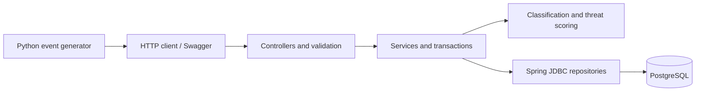

# Mini WSA

A Java 17 / Spring Boot security analytics backend: ingest events, classify attacks,
compute threat scores, and query summaries, samples and time-series data.
PostgreSQL stores the enriched events; a Python generator simulates attack waves.

## Quick start

With Docker Desktop running, from the repository root:

```bash
docker compose up --build -d --wait
```

Ports 8080 and 5432 must be available; stop any local app instance first.
No host JDK or Maven is needed. The first build requires internet access.
Flyway applies the schema automatically. Open [Swagger UI](http://localhost:8080/docs).

Ingest an event and retrieve its enriched representation:

```bash
curl -i -X POST http://localhost:8080/v1/events/ingest \
  -H 'Content-Type: application/json' \
  --data-binary @examples/event.json

curl 'http://localhost:8080/v1/events/samples?limit=2'
```

Ingestion returns 201. Reusing an existing `eventId` returns 409; change the ID to
submit another event. Stop with `docker compose down`; data remains in the named volume.
`docker compose down -v` deletes that data. Use `docker compose logs --tail=100 app`
for startup diagnostics. The root URL `/` has no endpoint; use `/docs`.

## Architecture



One Spring Boot application with four packages:

- `api`: HTTP endpoints, input validation, error responses and OpenAPI documentation.
- `domain`: immutable event/query/result records, enums and scoring rules.
- `service`: workflow coordination and transaction boundaries.
- `repository`: parameterized SQL, batch inserts and result mapping.

Ingestion validates the complete request, locks involved IPs, reads recent counts,
assigns enrichment, and inserts the batch in one transaction. Read APIs aggregate or
paginate in PostgreSQL. Summary and samples use repeatable-read transactions so their
multiple queries observe a consistent snapshot. Flyway manages four schema migrations.


## Why PostgreSQL and Spring JDBC?

PostgreSQL provides durable storage, atomic transactions, unique event IDs, indexed
filtering and SQL aggregation in one dependency. Query dimensions are typed columns;
JSONB preserves the complete original event. Indexes cover IP/arrival-time lookups,
configuration/event-time filtering and stable sample ordering.

`NamedParameterJdbcTemplate` suits batch ingestion and explicit analytical queries.
There are no entity relationships or frequent entity updates that currently justify an
ORM. JPA remains a reasonable alternative if that domain evolves. Named parameters bind
all values, and JDBC batch inserts enable the PostgreSQL driver's batch rewrite.

## API

Swagger UI: `/docs`; OpenAPI JSON: `/v3/api-docs`.

- **POST `/v1/events/ingest`** — one event or an array of 1–1000. Validates fields,
  enum values, IP literals, supported ISO-8601 timestamps and storable Unicode text. Returns `accepted` and enriched
  `events` with `attackType`, `threatScore` and server-assigned `receivedAt`.
- **GET `/v1/stats/summary`** — required `from`/`to`, optional `configId`. Returns
  total events, category counts/average scores, action counts and top ten IPs/paths.
- **GET `/v1/events/samples`** — optional `configId`, `from`, `to`, `category`,
  `action`, `limit` (default 20, max 100) and `offset` (default 0). Returns matching
  `total` plus complete events, ordered by timestamp then event ID descending.
- **GET `/v1/stats/timeseries`** — optional bonus. Required `from`, `to` and
  `interval` (`1m`, `5m`, `1h`), optional `configId`. Returns UTC-aligned buckets,
  including zero counts, in ascending order; requests are limited to 2000 buckets.

```bash
curl --get http://localhost:8080/v1/stats/summary \
  --data-urlencode 'from=2026-05-20T00:00:00Z' \
  --data-urlencode 'to=2026-05-21T00:00:00Z'

curl --get http://localhost:8080/v1/stats/timeseries \
  --data-urlencode 'from=2026-05-20T00:00:00Z' \
  --data-urlencode 'to=2026-05-20T05:00:00Z' \
  --data-urlencode 'interval=1m'
```

Query time bounds are inclusive and use the original event timestamp. Omit `configId`
to query all configurations. Time-series edge buckets can be partial, and a bucket
starting exactly at `to` is included. All API timestamps must be within years 0001–9999.
Ingested event timestamps must have at most microsecond precision (six fractional digits);
higher effective precision returns 400, preventing silent rounding of the original timestamp.
Query bounds may be more precise and round inward to PostgreSQL microseconds, avoiding
records outside the requested interval.
Full request/response schemas and examples are available in Swagger UI.

Errors use Problem Details: 400 for invalid input, 409 for stored duplicate IDs,
503 for handled temporary storage failures and 500 for other data-access failures.
Failed batches roll back. For an uncertain outcome after a lost response or 503, retry
with the same event IDs; duplicate rejection prevents duplicate rows but does not replay
the original success response. SQL and exception details are not returned to clients.

## Scoring and repeat-offender decisions

- Severity: CRITICAL 40, HIGH 30, MEDIUM 20, LOW 10.
- Action: DENY +20, ALERT +10, MONITOR +0.
- Sensitive path: +15 once if it contains `/admin` or `/login` (case-sensitive).
- Repeat offender: +15 from the sixth arrival for the same canonical IP within ten minutes.
- Cap at 100. Category-to-attack-type mappings follow the assignment.

The repeat window uses **server arrival time**, independently of client timestamps.
It includes the ten-minute boundary and spans configurations. One batch shares one
`receivedAt`; its input order determines which event is sixth. Scores are stored once.

Transaction-scoped advisory locks coordinate concurrent writers. Java sorts and deduplicates
numeric lock keys, then acquires them sequentially. This makes ordering explicit but costs
one call per unique key, in addition to key lookup. History queries stop at five prior
matches per IP. Locks release on commit/rollback; read-committed isolation lets the history
query see the preceding writer’s commit after waiting for its lock.

## Local development and tests

Requires JDK 17+; the Maven Wrapper is included. Docker supplies PostgreSQL and isolated
integration-test databases. If the app is running in Compose, stop it before local startup:

```bash
docker compose stop app
docker compose up -d --wait db
./mvnw spring-boot:run
```

Database defaults: `jdbc:postgresql://localhost:5432/miniwsa`, user/password `miniwsa`.
Override with `DB_URL`, `DB_USERNAME`, `DB_PASSWORD`. Compose reads `.env`; local Java
requires exported variables. See [.env.example](.env.example) for optional host ports.
Changing a password after volume initialization does not change the stored database password.
If `DB_PORT` changes, update local Java’s `DB_URL` too.

For automatic restart in VS Code, install Extension Pack for Java, keep Java autobuild enabled,
and click Run above `MiniWsaApplication.main`. DevTools restarts after changed classes compile;
source-file saves alone do not trigger restart when running Maven without an IDE compiler.
To run the packaged app: `./mvnw package -DskipTests`, then
`java -jar target/mini-wsa-0.1.0-SNAPSHOT.jar`. DevTools is excluded from the packaged JAR.

```bash
./mvnw test          # Unit tests; no Docker required
./mvnw clean verify  # All Java tests, including real HTTP/PostgreSQL integration tests
python3 -m unittest discover -s scripts -p 'test_*.py'
```

The current suite has 242 Java tests and four generator tests, covering classification,
scoring, validation, rollback, concurrency, migrations, query consistency and time boundaries.
A clean-source build and an isolated full-stack startup were verified, including data
persistence across restarts. The Docker image build skips tests; run `verify` separately.
On Windows use `mvnw.cmd`. Integration tests use separate disposable PostgreSQL containers.
If Testcontainers cannot find Docker Desktop’s socket on macOS, export
`DOCKER_HOST="unix://$HOME/.docker/run/docker.sock"` before running `verify`.

## Generate data

Python 3.9+, standard library only. Generate 10,000 events in 20 files of 500:

```bash
python3 scripts/generate_events.py --count 10000 --seed 42 \
  --start 2026-05-20T00:00:00Z --output generated/demo-001
```

Submit the generated files to the running application (Bash/Zsh):

```bash
for batch in generated/demo-001/batch-*.json; do
  curl --fail-with-body --silent --show-error \
    -X POST http://localhost:8080/v1/events/ingest \
    -H 'Content-Type: application/json' --data-binary "@$batch" \
    -o /tmp/mini-wsa-ingest-response.json || break
done
```

Use a new output directory for another run; do not resend successful batches.
Each file is a separate transaction. The generator includes all categories/actions,
three configurations and 50-event attack waves from the same IP/path. Seed and start
reproduce content, while each run gets unique event IDs. Options include `--batch-size`
(1–1000, default 500), `--count`, `--seed`, `--start` and required `--output`;
run `python3 scripts/generate_events.py --help` for details.

## Challenges, limitations and future improvements

- **Atomic ingestion:** validate before writes, use a transaction and a primary key to
  reject duplicates without partial batches; verify rollback through real HTTP/DB tests.
- **Concurrent scoring:** sorted IP locks and request-local counts keep the sixth-event
  rule consistent across batches. Tests use an injected clock rather than sleeps.
- **Time semantics:** event time serves analytics; arrival time serves repeat scoring.
  Keeping these separate makes delayed/out-of-order logs predictable.
- **Retry lesson:** a missing response does not establish whether commit succeeded.
  Stable event IDs prevent duplicate rows; a full idempotency-key API is a future extension.

Local measurements processed 10K / 100K events in 0.963 / 7.554 seconds of summed HTTP
time with one writer and batches of 500. These are workload-specific observations, not
production-capacity claims. [Raw measurements](docs/performance/2026-10-23/results.json)
record Docker CPU/memory and architecture; the same directory contains aggregation and
repeat-history `EXPLAIN (ANALYZE, BUFFERS)` plans and a 1000-distinct-IP batch check.

Reproduce the 10K/100K benchmark with:

```bash
python3 scripts/benchmark.py --output generated/benchmark-001
```

It builds an isolated Compose stack, uses fresh data for each scenario, warms the app,
refreshes DB statistics and records warm query plans. It removes only its temporary stack
and volume. Generation is excluded from timing; serialization, HTTP and response parsing
are included. The five warm summary requests are illustrative, not a statistical load test.

Before production, measure concurrent writers, hot-IP contention, remote DB latency,
p95/p99 and dataset/index growth. Broad aggregations, exact counts and deep offsets can
be expensive. Consider retention/time partitioning, rollups and keyset pagination based
on measurements; global event-ID uniqueness needs explicit treatment with partitioning.
Add authentication/tenant authorization, request-byte limits, observability, external
secrets and a clock-skew policy. Queue-based buffering is an option if burst requirements
justify it; the assignment currently runs as one service and one database.
